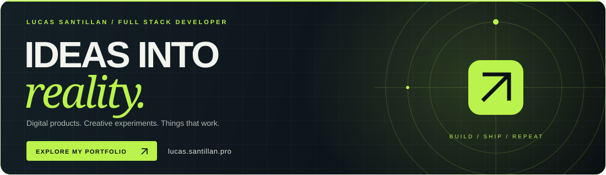
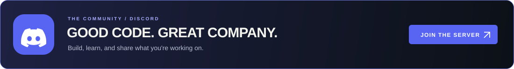

  <ul align="center">
    
<h1 style="display: inline-block; color: red">Hi 👋, I'm Lucas Santillan</h1>

  </ul>

  

<!-- Banner -->

  

#

## 👋 About Me!

I'm a **passionate software developer** 🌟 with a strong enthusiasm for **continuous learning** 📚 and exploration in the tech world 💻.

### 🌐 My Interests
- **Web Development** 🌍
- **Mobile Development** 📲
- **Machine Learning** 🤖  
- **Systems Programming** 🛠️  

🚀 I'm always excited to dive into **new technologies** and frameworks, eager to build innovative solutions and grow as a developer. 💡

## 🤓☝️ Milestones

- ⭐ Github Star ⭐
- 🧊 MSP Founder
- ▶️ Youtuber +5k Followers
- </> Full Stack Developer
- 👾 APEC Hackathon Regional Winner

#

<!--Intro start-->
## 🔧 Skills

- **Documentation:** Notion
- **Frameworks:** Spring Boot, Django, Strapi, Trcp, Angular, Vue, React, Next.js, Node.js, Serverless
- **Databases:** MySQL, SQLServer, PostgreSQL, MongoDB,
- **Languages:** Go, C++, Python, PHP, Java, HTML, CSS3, TypeScript, JavaScript, Dart
- **Design:** Photoshop, Premiere Pro, After Effects, Audition, Cinema4D
- **Others:** Blockchain y Web3, Machine Learning, Kubernetes, Docker, AWS

- 💬 Ask me about **any technology you find here**

- 📫 Feel free to reach me out **lucasraulsa@outlook.com**

- 🏠 Don't hesitate to drop me a **👋** on LinkedIn –  [lucassantillana](https://www.linkedin.com/in/lucassantillana/) my username!
<!--Intro end-->

## Development stack

<table>
  <tr>
    <td width="50%" valign="top">
      <h3>Web development</h3>
      
Interfaces &amp; web applications

      
      
Svelte · TypeScript · React · Next.js · Tailwind CSS

    </td>
    <td width="50%" valign="top">
      <h3>Backend &amp; systems</h3>
      
APIs, services &amp; systems programming

      
      
Go · Rust · Node.js · Python

    </td>
  </tr>
  <tr>
    <td width="50%" valign="top">
      <h3>Mobile development</h3>
      
Cross-platform applications

      
      
Flutter · Dart

    </td>
    <td width="50%" valign="top">
      <h3>Infrastructure &amp; data</h3>
      
Shipping, storage &amp; version control

      
      
Docker · PostgreSQL · Git

    </td>
  </tr>
</table>

<!-- Connect with me -->

  

<!--h2 without bottom border-->

  <ul align="center">
    
<h2 style="display: inline-block"> 📫 Connect With Me🤝</h2>

  </ul>

<!--icons and links-->

  <ul align="center">
    
<h2 style="display: inline-block">MY GITHUB STATS 📈</h2>

  </ul>

